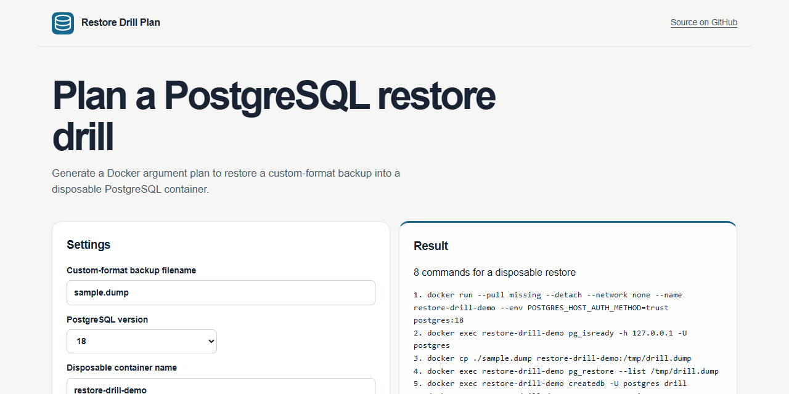

# Restore Drill Plan

**Plan a PostgreSQL restore drill.** Generate a Docker argument plan to restore a custom-format backup into a disposable PostgreSQL container.

[Open the live tool](https://musabukhari237.github.io/restore-drill-plan/) · [Report an issue](https://github.com/MusaBukhari237/restore-drill-plan/issues)

[](https://musabukhari237.github.io/restore-drill-plan/)

## Try an example

Load the example and generate the plan. Review the eight commands and download the JSON argument arrays.

## Usage and limits

Review the commands individually and stop on any failure. Use a trusted custom-format backup. The plan specifies an isolated container with no published ports. Its table listing checks that the restored schema is accessible. Verify application-level data separately. [pg_restore manual](https://www.postgresql.org/docs/current/app-pgrestore.html)

## Run locally

Clone this repository, then run:

```sh
python -m http.server 8000 --bind 127.0.0.1 --directory docs
```

Open http://127.0.0.1:8000 in a browser. The site needs no package install. Run `node --test` with Node.js 22 or newer.

## Sponsors

Supported by [LeadCeleris](https://www.leadceleris.com/) and [AIFFICIENTO](https://www.aifficiento.biz/).

## Contributing and license

Use synthetic input in bug reports and contributions. See [contribution notes](CONTRIBUTING.md) and the [MIT license](LICENSE).
